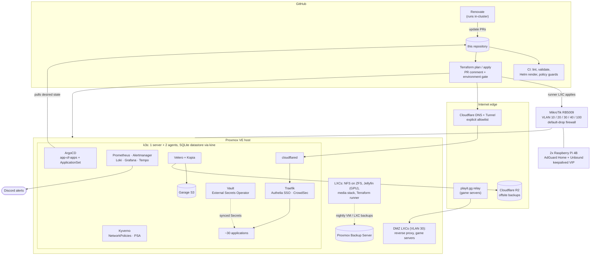

[](https://github.com/dwoitzik/homelab-infrastructure/actions/workflows/ci.yml)


# Homelab Infrastructure as Code

A self-hosted platform run like production and managed entirely from this repository:
the router firewall, the Proxmox VMs and containers, a three-node Kubernetes cluster and
about 30 applications on top of it. Nothing is changed by hand. Network and hypervisor
changes go through Terraform in pull requests, cluster state is reconciled by ArgoCD,
and host configuration is applied with Ansible.

It is in daily use (photos, media, documents, passwords, home automation), so it has
real failure modes: a full rebuild from bare metal, datastore corruption under I/O
pressure, a backup job that filled its own disk, alerts that went silent. The interesting
part of this repo is how those were found, fixed and then guarded against so they stay
fixed. That reasoning is recorded in [70+ Architecture Decision Records](docs/decisions/).

## Architecture



## Stack

| Layer | Choice | Why (decision record) |
|---|---|---|
| Hypervisor | Proxmox VE on a single mini PC (Ryzen 7 5825U, 64 GB) | Hardware constraints in [HARDWARE.md](docs/HARDWARE.md) |
| Network | MikroTik RB5009, five VLANs, default-drop forward and input chains, all rules in Terraform | [vlan-segmentation.md](docs/vlan-segmentation.md) |
| Edge DNS | AdGuard Home + Unbound on two Raspberry Pis behind a keepalived VIP | [ADR-001](docs/decisions/ADR-001-unbound-recursive-dns.md), [ADR-002](docs/decisions/ADR-002-keepalived-edge-ha.md) |
| Kubernetes | k3s, one server and two agents, SQLite (kine) instead of etcd | [ADR-014](docs/decisions/ADR-014-etcd-topology.md), [ADR-015](docs/decisions/ADR-015-k3s-datastore-sqlite.md) |
| GitOps | ArgoCD; any new folder under `kubernetes/apps/` is picked up by an ApplicationSet | [k3s-architecture.md](docs/k3s-architecture.md) |
| Infrastructure as code | Terraform (router, Proxmox, Cloudflare, Garage), state in Garage S3; Ansible for hosts | [ADR-003](docs/decisions/ADR-003-garage-terraform-backend.md), [ADR-021](docs/decisions/ADR-021-atlantis-off-public-internet.md) |
| Ingress and auth | Traefik, cert-manager (DNS-01), Authelia SSO/OIDC backed by CloudNativePG, CrowdSec bouncer | [ADR-006](docs/decisions/ADR-006-cloudnativepg-authelia.md) |
| External access | Cloudflare Tunnel for an explicit allowlist of hostnames; everything else is LAN or tailnet (Headscale) only | [ADR-011](docs/decisions/ADR-011-cloudflare-tunnel-external-access.md), [ADR-033](docs/decisions/ADR-033-public-exposure-allowlist.md) |
| Secrets | HashiCorp Vault with auto-unseal, External Secrets Operator; Ansible Vault for hosts | [ADR-009](docs/decisions/ADR-009-vault-auto-unseal.md) |
| Policy | Kyverno (resource limits, no `latest`, no privileged), Pod Security Admission, default-deny NetworkPolicies | [ADR-008](docs/decisions/ADR-008-networkpolicy-default-deny.md) |
| Storage | NFS on ZFS for shared volumes, `local-path` for SQLite-backed apps, CloudNativePG for Postgres | [ADR-005](docs/decisions/ADR-005-nfs-over-longhorn.md), [ADR-016](docs/decisions/ADR-016-storage-class-policy.md) |
| Backups | Velero + Kopia to Garage, daily offsite copy to Cloudflare R2, Proxmox Backup Server for VMs and LXCs | [ADR-004](docs/decisions/ADR-004-backup-strategy.md), [ADR-007](docs/decisions/ADR-007-velero-kopia-pvc-backup.md), [ADR-062](docs/decisions/ADR-062-offsite-r2-3-day-retention.md) |
| Observability | kube-prometheus-stack, Loki, Tempo, blackbox probes with SLO burn-rate alerts, Alertmanager to Discord | [monitoring README](kubernetes/system/monitoring/README.md) |
| Updates | Renovate every two hours; digest-pinned images; patch updates auto-merge only after CI and a soak period | [ADR-063](docs/decisions/ADR-063-renovate-digest-minimum-release-age.md), [ADR-071](docs/decisions/ADR-071-ansible-role-images-digest-pinned.md) |

## How changes are deployed

**Kubernetes.** A merged manifest is a deployment. ArgoCD syncs `kubernetes/` with
self-heal on, so hand edits in the cluster are reverted.

**Terraform.** Never applied from a laptop. On a pull request, a comment
`atlantis plan -d <stack>` runs the plan on a self-hosted runner and posts it to the PR
([terraform-plan.yml](.github/workflows/terraform-plan.yml)). `atlantis apply -d <stack>`
triggers [terraform-apply.yml](.github/workflows/terraform-apply.yml), which waits on the
`terraform-apply` GitHub Environment for approval. Only the repository owner can trigger
either workflow, and both refuse to run code from forks. (The comment keywords are kept
from the Atlantis setup this replaced; see ADR-021.)

**Ansible.** Roles per service (34 roles), run in check mode first:

```bash
ansible-playbook ansible/site.yml --check --diff --limit <group>
ansible-playbook ansible/site.yml --limit <group>
```

**Dependencies.** Renovate opens PRs for container images, Helm charts, GitHub Actions
and Terraform providers. Helm chart patch releases auto-merge only after the CI job
[render-helm-applications.py](scripts/render-helm-applications.py) proves that every
chart referenced by an ArgoCD Application still renders with this repo's values against
the cluster's Kubernetes version and passes kubeconform. Chart minors and majors, 0.x
charts and stateful services stay PR-only.

## Engineering practices

**Verify against live state, not reported status.** A green workflow, a "Synced" badge
or a sysctl that reads `1` is a claim, not proof. Changes are checked against the real
route, DNS answer, rule or pod afterwards. [ADR-043](docs/decisions/ADR-043-exit-node-ipv6-false-advertisement.md)
is the clearest example: the forwarding sysctl was set correctly, but the pod had no
IPv6 uplink at all.

**Every failure mode gets a mechanical guard.** When something breaks silently once, the
check that would have caught it is committed so it runs whether or not anyone remembers:

| Guard | What it catches |
|---|---|
| [drift-check.yml](.github/workflows/drift-check.yml) every 30 min | objects declared in git that never became live ([ADR-027](docs/decisions/ADR-027-declared-vs-live-drift-guard.md)) |
| [tailnet route drift check](kubernetes/system/monitoring/tailnet-route-drift-check.yml) every 15 min | Headscale route approvals drifting from the intended state |
| [Kyverno policy drift check](kubernetes/system/monitoring/kyverno-policy-drift-check.yml) | running pods that violate policy (background scans are off to save datastore writes) |
| [Dead man's switch](kubernetes/system/monitoring/dead-mans-switch.yml) | the whole cluster going quiet, detected from outside |
| [Monthly restore test](kubernetes/system/velero/restore-test.yml) | backups that complete but do not restore |
| [Quarterly DR game day](kubernetes/system/monitoring/dr-game-day.yml) | a recovery procedure that no longer matches reality |
| [R2 usage guard](kubernetes/system/velero/r2-usage-guard.yml) | offsite backups running past the storage budget |
| [Silent-failure alerts](kubernetes/system/monitoring/silent-failure-alerts.yml) | operators down, backups stopping, log sources going stale |

**Pre-commit and CI gates.** Pre-commit hooks and CI run terraform fmt, validate and
tflint, ansible-lint, yamllint, markdownlint, kubeconform against vendored schemas,
gitleaks, and four repository-specific guards in [scripts/](scripts/):

- `check-disclosure.py`: blocks new credentials and new infrastructure identifiers in
  this public repo ([ADR-048](docs/decisions/ADR-048-public-repo-disclosure-policy.md)).
- `check-argocd-include-coverage.py`: fails when a manifest is added to a directory but
  missing from the ArgoCD include glob that would deploy it.
- `check-host-memory-overcommit.py`: keeps VM memory reservations under the host ceiling
  that previously froze the hypervisor.
- `check-comment-narration.py`: keeps investigation diaries out of code comments.

**Decisions are written down.** Each non-trivial choice has an ADR with context,
alternatives and consequences, including the ones that turned out wrong and were
superseded. A selection:

- [ADR-015](docs/decisions/ADR-015-k3s-datastore-sqlite.md): SQLite instead of etcd,
  because etcd's fsync pattern locked up a host with a DRAM-less NVMe.
- [ADR-021](docs/decisions/ADR-021-atlantis-off-public-internet.md): replacing Atlantis
  with GitHub Actions so nothing holding Terraform credentials is reachable from the
  internet.
- [ADR-033](docs/decisions/ADR-033-public-exposure-allowlist.md): public exposure as an
  explicit allowlist instead of a wildcard tunnel.
- [ADR-028](docs/decisions/ADR-028-mechanical-secret-exposure-prevention.md): preventing
  credential leaks by construction rather than by remembering a rule.
- [ADR-038](docs/decisions/ADR-038-r2-offsite-backup-checksum-fix.md): why every
  offsite backup to R2 failed for a week, and the plugin fix.
- [ADR-046](docs/decisions/ADR-046-vault-goroutine-leak-externalsecrets.md): a Vault
  goroutine leak that left every ExternalSecret failing, unalerted, for about 20 days.
- [ADR-063](docs/decisions/ADR-063-renovate-digest-minimum-release-age.md): why digest
  updates never auto-merged, and the Renovate setting that fixed it.

Full index: [docs/decisions/](docs/decisions/README.md).

## Repository layout

```text
.
├── kubernetes/
│   ├── apps/          # one folder per application, deployed by an ArgoCD ApplicationSet
│   └── system/        # platform components, each with its own ArgoCD Application
├── terraform/stacks/
│   ├── network/       # MikroTik: VLANs, firewall, DHCP, NAT, DNS
│   ├── proxmox/       # VMs and LXCs
│   ├── cloudflare/    # tunnel ingress and public DNS allowlist
│   └── garage/        # S3 buckets
├── ansible/           # roles per host service, site.yml, k3s provisioning
├── scripts/           # pre-commit and CI guards, Helm render gate
├── ci/                # vendored kubeconform schemas
├── docs/
│   ├── decisions/     # ADRs
│   └── runbooks/      # failover procedures
├── .github/workflows/ # CI, Terraform plan/apply, drift check
└── DISASTER-RECOVERY.md
```

## Documentation

- [Disaster recovery](DISASTER-RECOVERY.md): bare metal to a running cluster, written
  from a real full rebuild.
- [Operating model](docs/OPERATING-MODEL.md): what updates itself, what alerts, what
  stays manual and why.
- [Backup strategy](docs/backup-strategy.md)
- [k3s architecture](docs/k3s-architecture.md) and [hardware constraints](docs/HARDWARE.md)
- [Network segmentation](docs/vlan-segmentation.md)
- [Roadmap](docs/ROADMAP.md)

## License

[MIT](LICENSE)
